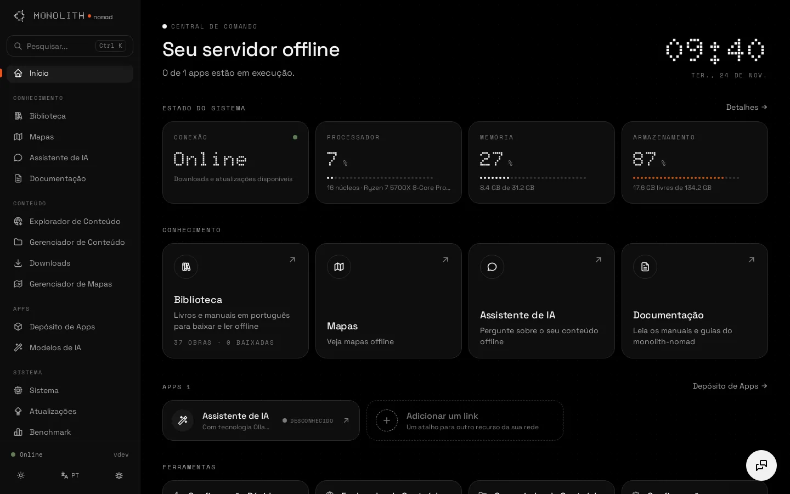

# monolith-nomad

**Servidor de conhecimento offline**, em português do Brasil: Wikipédia, cursos, livros, mapas e IA local num hardware que é seu. Depois do download, nada depende de internet.



## Recursos

| Recurso | Base | O que oferece |
|---|---|---|
| Biblioteca | Embutido | Livros e manuais em PDF, EPUB e ZIM, filtros por área, assunto, idioma e nível, leitores integrados |
| Biblioteca de Informação | [Kiwix](https://kiwix.org/) | Wikipédia offline, referências médicas, guias práticos |
| Assistente de IA | [Ollama](https://ollama.com/) + [Qdrant](https://qdrant.tech/) | Chat local com Base de Conhecimento (RAG) |
| Plataforma de Educação | [Kolibri](https://learningequality.org/kolibri/) | Cursos, exercícios e progresso por aluno |
| Mapas | [Protomaps](https://protomaps.com) | Brasil inteiro, regiões ou estados; outros países à parte |
| Depósito de Apps | Embutido | Apps em um clique (PDF, arquivos, senhas, mídia...) e containers próprios |
| Benchmark | Embutido | Pontuação de CPU, memória, disco e IA |

**Diferenciais:**

- **Brasil por padrão:** interface, documentação e catálogo em pt-BR, fuso e formatos brasileiros, conteúdo em inglês opcional. Ver [`docs/catalogo.md`](docs/catalogo.md).
- **Configuração Rápida em quatro etapas:** recursos, mapas, conteúdo (perfis Essencial, Padrão e Completo) e revisão com o tamanho total e o espaço livre.
- **Downloads inteligentes:** mirrors oficiais do Kiwix medidos antes de baixar, aria2c com retomada e SHA-256 conferido antes de instalar. Ver [`docs/downloads.md`](docs/downloads.md).
- **Interface Nothing:** monocromática, com matriz de pontos e o laranja do Ubuntu como destaque. Ver [`docs/design-system.md`](docs/design-system.md).
- **GPU AMD (ROCm) e NVIDIA** para o Assistente de IA.

## Requisitos

| | Mínimo (sem IA) | Recomendado (com IA) |
|---|---|---|
| **Sistema** | Ubuntu 24.04 LTS ou Debian 12, x86_64 | Ubuntu 26.04 LTS |
| **CPU** | 2 núcleos, 2 GHz | Ryzen 7 / Core i7 |
| **RAM** | 4 GB (o sistema usa menos de 1 GB) | 32 GB |
| **Disco** | 10 GB + conteúdo | 250 GB ou mais, SSD |
| **GPU** | — | Radeon com ROCm ou RTX 3060 |

Internet só na instalação e nos downloads. A IA também pode rodar em outra máquina: informe a URL de um Ollama (`OLLAMA_HOST=0.0.0.0`) ou de uma API compatível com a OpenAI nas configurações do Assistente.

## Instalação

```bash
sudo apt-get update && \
sudo apt-get install -y curl && \
curl -fsSL https://github.com/jhonatanoliveira2/monolith-nomad/releases/latest/download/install_nomad.sh \
  -o install_nomad.sh && \
sudo bash install_nomad.sh
```

O instalador verifica o host, instala o Docker se faltar, configura a GPU NVIDIA, o fuso (America/Sao_Paulo quando o host está em UTC) e o locale pt_BR.UTF-8. Ao terminar, abra `http://IP_DO_SERVIDOR:8080` e siga a **Configuração Rápida**.

| Variável | Uso |
|---|---|
| `NOMAD_TZ=America/Manaus` | Outro fuso horário |
| `NOMAD_RELEASE_TAG=v1.2.0` | Uma release específica |
| `NOMAD_GITHUB_REPO=dono/repo` | A última release de outro fork |
| `NOMAD_GITHUB_BRANCH=main` | Um branch (só desenvolvimento) |

Exemplo: `NOMAD_TZ=America/Manaus sudo -E bash install_nomad.sh`. **Rodar o instalador de novo não atualiza:** ele recria as credenciais e zera o banco.

**Instalação manual:** use o [compose da última release](https://github.com/jhonatanoliveira2/monolith-nomad/releases/latest/download/management_compose.yaml), troque os valores `replaceme` e rode `docker compose up -d`.

| Item | Valor |
|---|---|
| Central de Comando | porta `8080` |
| Logs (Dozzle) | porta `9999` |
| Instalação e dados | `/opt/project-nomad`, `/opt/project-nomad/storage` |
| Containers | prefixo `nomad_` |

Os nomes técnicos `/opt/project-nomad`, `nomad_*` e `project-nomad*` são mantidos para que instalações existentes continuem atualizando.

## Manutenção

```bash
sudo bash /opt/project-nomad/start_nomad.sh    # iniciar
sudo bash /opt/project-nomad/stop_nomad.sh     # parar
sudo bash /opt/project-nomad/update_nomad.sh   # atualizar a Central (os apps, pela interface)
```

**Atualizações** pela interface (**Sistema → Atualizações**). As automáticas são opcionais, rodam numa janela de horário, esperam um período após cada release e nunca pulam de versão principal. Para simular a decisão sem atualizar: `node ace auto-update:dry-run --scenarios` (em `admin/`).

**Desinstalar** (apaga todos os dados, sem volta):

```bash
curl -fsSL https://github.com/jhonatanoliveira2/monolith-nomad/releases/latest/download/uninstall_nomad.sh -o uninstall_nomad.sh && sudo bash uninstall_nomad.sh
```

## Privacidade e segurança

- **Sem telemetria.** Serviços online de terceiros (leaderboard, newsletter, lista remota de modelos) ficam desligados por padrão ([`docs/distribuicao.md`](docs/distribuicao.md)).
- O teste de conexão consulta `1.1.1.1` e, como reserva, a API do GitHub. Troque em **Sistema → Avançado** ou com `INTERNET_STATUS_TEST_URL`.
- **Não há autenticação.** Quem está na rede local acessa tudo. Limite o acesso pela rede e **não exponha o servidor à internet**.
- Vulnerabilidades: [`SECURITY.md`](SECURITY.md).

## Documentação

| Documento | Assunto |
|---|---|
| [`admin/docs/`](admin/docs/) | Documentação exibida no app (primeiros passos, FAQ, apps, atualizações, API) |
| [`docs/downloads.md`](docs/downloads.md) | Downloads inteligentes |
| [`docs/catalogo.md`](docs/catalogo.md) | Catálogo em português |
| [`docs/design-system.md`](docs/design-system.md) | Sistema visual e componentes |
| [`docs/distribuicao.md`](docs/distribuicao.md) | Imagens, releases e variáveis |
| [`admin/inertia/locales/README.md`](admin/inertia/locales/README.md) | Traduções |

Contribuições: [`CONTRIBUTING.md`](CONTRIBUTING.md) · [Código de Conduta](CODE_OF_CONDUCT.md) · [Issues](https://github.com/jhonatanoliveira2/monolith-nomad/issues).

## Licença

[Apache License 2.0](LICENSE). Obra derivada do Project N.O.M.A.D., Copyright 2024-2026 Crosstalk Solutions, LLC; não é afiliada ao projeto original nem endossada por ele. Os arquivos alterados estão em [`MODIFICATIONS.md`](MODIFICATIONS.md), e os créditos, licenças e marcas de terceiros (Ubuntu/Canonical, Nothing), em [`THIRD_PARTY_NOTICES.md`](THIRD_PARTY_NOTICES.md).
